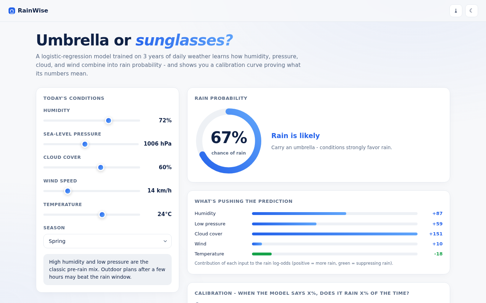
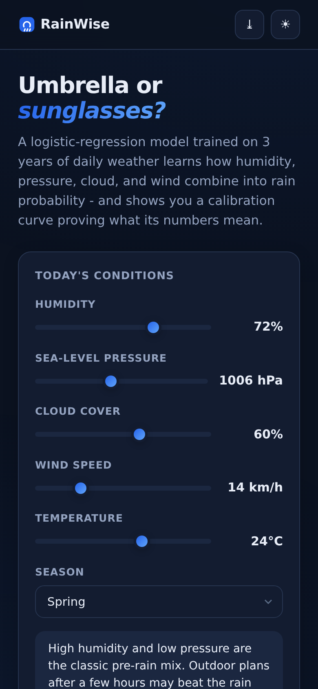

# RainWise - Rainfall Probability Predictor

Umbrella or sunglasses? A **logistic-regression model trained live in your browser** on 3 years of daily weather, with an honest calibration curve.

**Live demo:** https://akash991833.github.io/rainfall-predictor/

## Features

- **Real ML pipeline** - logistic regression trained by gradient descent on 1,095 simulated days; training time measured and displayed
- **Probability gauge** - animated SVG arc with plain-English verdicts and practical advice
- **Factor contributions** - each input's push on the rain log-odds, visualized
- **Calibration curve** - "when the model says 70%, does it rain 70% of the time?" with per-bin sample counts, plus Brier score and accuracy measured on the data
- **Monsoon-aware** - season selector models seasonal rainfall regimes
- **PWA** - installable, offline after first load
- **Premium UI** - white professional design, navy ink, blue accent, dark + light themes, responsive desktop and mobile

## Screenshots




## Honest limits

Open weather APIs require keys, so training data is **simulated** from realistic climatology (labeled in-app). The model, calibration measurement, and Brier score are real. This is a teaching-grade model - check a real forecast before canceling plans.

## Tech

Vanilla HTML/CSS/JS, zero dependencies.

## Run locally

Open `index.html` or serve the folder (`python3 -m http.server`).

---

## 🐍 Python version (real ML backend) - `python-app/`

The browser demo above is fully client-side. This folder is the **pro-grade version** with a real training pipeline on real data:

Next-day rain for Lucknow from 6 years of real Open-Meteo/ERA5 weather. 90.6% accuracy, AUC 0.93. Stack: Python, Streamlit, XGBoost.

```bash
cd python-app
pip install -r requirements.txt
streamlit run app.py
```

Deploy free on **Hugging Face Spaces** (no card): create a Space, upload the `python-app/` folder - it ships Space-ready (`sdk` + `app_file` already set in its README). Retrain anytime with `python train.py` (where present).
